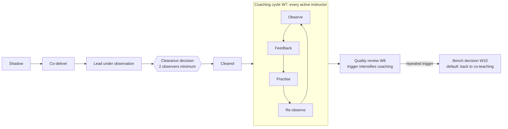

# Instructor Development Infrastructure — Specification v0.2

23 Oct 2026 · Gareth Clarke · Draft v0.2 · experienced-engineer edition

> Snapshot of the working spec, exported on 2026-10-23. Machine-readable rules live in `standards/`; if they disagree
> with this file, `standards/` wins and this file is stale.

## Purpose and scope

Every instructor-led session in a technical training function for experienced engineers is delivered by someone cleared against a written standard by at least two calibrated observers, and every decision about an instructor rests on recorded evidence. This system holds that standard, the evidence and the decisions.

This edition adapts v0.1 (7 Oct 2026, written for a different training organisation) to a training function that teaches experienced software engineers to build with new platforms, APIs and tooling. It keeps v0.1's structure and changes its rules only where the evidence is rated strong.

**Instructors:** practising software engineers who teach part-time (internal enablement, developer relations), professional technical instructors, contract instructors and partner instructors.

**Learners:** mostly experienced engineers (internal staff, customer engineering teams, external developers). Seniority in general software engineering does not imply expertise in the topic being taught.

**In scope:** the instructor competency framework and observation rubric; observations, dry-runs and clearance records; observer calibration and audit; the coaching cycle; the train-the-trainer pathway; CPD; per-instructor quality review; bench decisions (renew, convert, return to co-teaching, exit); partner instructor clearance; converting expert material into teachable sessions.

**Out of scope:** learner enrolment and grading (the LMS stays the record); payroll, contracts and performance reviews (referenced, not held); content authoring and course versioning (the curriculum repositories).

**Design principles**

- **People decide, the system records.** Rules check that evidence is complete; named clearers make every clearance and bench decision.
- **Evidence over impression.** Every score carries an evidence note or a recording timestamp.
- **No decision on one pair of eyes.** Clearance and bench decisions need observations from at least two calibrated observers.
- **Coaching is continuous.** Every active instructor is in a coaching cycle; a quality trigger intensifies it.
- **One standard for everyone.** Staff, SME engineers, contractors and partner instructors are cleared the same way; only the scope differs.
- **Abandonable.** If the system is down, a session runs from the paper run sheet and rubric, and the record is entered afterwards.
- **Minimum data on people.** Hold what a decision needs, aggregate learner data, and give instructors full sight of their own record.

## What changed from v0.1

Four findings rated strong change the rules; everything rated moderate or weak is listed under *Evidence considered and deferred* and changes nothing yet. The context changes (instructor types, data sources, privacy law) follow from the new setting, not from evidence.

| Change | v0.1 | v0.2 | Evidence (strong) |
| --- | --- | --- | --- |
| Multi-rater clearance | One clearer, one observed lead delivery | At least 2 observations by at least 2 different calibrated observers; scores averaged | One observer on one lesson gives reliability of about .27–.45; a second observer adds more than twice the reliability of a second lesson by the same observer (MET; Ho & Kane 2013) |
| Short observations | Full sessions only | 15-minute observations count toward the minimum | 15 minutes gave about 60% of full-lesson reliability in under a third of the time (MET) |
| Observation audit | Calibration every 6 months | Calibration plus a quarterly double-scored audit sample | MET recommends certifying observers on pre-scored video and auditing a subset |
| Single-score triggers | Any domain at 1 triggers review | A domain at 1 must be confirmed by a second observer before it triggers | Same reliability finding |
| Continuous coaching | Coaching plan opened only by a trigger | Every active instructor in a standing observe → feedback → practise → re-observe cycle; triggers intensify it | Coaching: +0.49 SD on teaching practice, +0.18 SD on achievement across 60 causal studies; virtual coaching comparable; effects smaller in large programmes (Kraft, Blazar & Hogan 2018) |
| Prior-knowledge diagnosis | Not in the framework | New competency domain; every module carries a per-topic diagnostic pre-check | Expertise reversal: support that helps novices hurts learners with more prior knowledge; robust across contexts (Kalyuga et al. 2003; 2025 meta-analysis) |
| Conceptual questioning | Generic assessment practice | Assessment domain anchored on diagnostic multiple-choice questions and peer discussion | Peer instruction halved fail rates in four CS courses (Porter, Bailey Lee & Simon 2013); learning happens in the discussion (Porter et al. 2011) |

Population caveat: coaching and observation-reliability effects come from K-12 classrooms, and peer instruction from university CS courses. The mechanisms are adopted here; the effect sizes are not promised.

## Users and roles

Seven roles act in the system; learners are a data source only, in aggregate.

| Role | Does | Sees |
| --- | --- | --- |
| Head of training | Owns the framework, rubric and rules; makes bench decisions; signs off clearers; sets coach capacity | Everything |
| Clearer | Observes, scores, runs dry-runs; joins a second clearer to make clearance decisions within their modules | Instructors and modules they assess |
| Coach | Runs the coaching cycle for assigned instructors; may be a clearer, but a coach's own observations count as one of the two observers at most | Assigned instructors' records |
| Observer in training | Scores sessions for calibration; cannot clear | Assigned recordings and their own scores |
| Instructor (SME engineer, professional, contractor, partner) | Self-assesses, receives feedback, practises, logs CPD, replies to or appeals a decision | Their own record only |
| Engineering manager or partner lead | Commits protected teaching time (SME engineers) or nominates instructors (partners); receives clearance status | Their people's clearance status, not scores |
| Programme coordinator | Schedules observations, coaching sessions and dry-runs; staffs deliveries from the cleared pool | Clearance register and schedules, not scores |

An instructor progresses through levels: **shadow → co-deliver → lead under observation → cleared → clearer**. A clearer is a cleared instructor who has passed observer calibration.

SME engineers teach alongside engineering duties, so their pathway runs at their delivery rate; the clearance rules do not relax for them.

## Competency framework

Five domains, each scored 1 (not yet) to 4 (exemplary) with behavioural anchors; two of them are new or re-anchored in v0.2 on strong evidence. The domain list is a proposal to confirm. Full anchors: `standards/rubric.yaml`.

| Domain | Covers | Proficient (3) looks like | Basis |
| --- | --- | --- | --- |
| Technical depth | Accuracy on the module's tools and concepts; honest at the edge of own knowledge | Answers correctly or says what they would test to find out; no content errors left uncorrected | v0.1 |
| Prior-knowledge diagnosis and adaptation | Finding out, per topic, what this room already knows, and adjusting support | Runs the module's pre-check, names what it showed, and skips or adds worked examples accordingly during the session | New: expertise reversal |
| Conceptual questioning | Diagnostic multiple-choice questions, vote, peer discussion, revote, instructor-led debrief | Uses at least one question whose wrong answers map to known misconceptions, and changes course on the result | Re-anchored: peer instruction |
| Live-lab facilitation and troubleshooting | Running hands-on labs, recovering from environment and model failures | Diagnoses a failing learner environment or a non-deterministic model output in front of the room and keeps the cohort moving | v0.1 |
| Remote and inclusive delivery | Pacing, accessibility and parity between in-room and remote learners | Remote learners get the same questions, checks and help queue as the room | v0.1 |

v0.1's *content adaptation* domain is absorbed into prior-knowledge diagnosis and adaptation.

## Domain model

The centre of the model is the **Clearance**: one instructor, one module, one decision, backed by observations from at least two calibrated observers and a dry-run, and stamped with the framework version it was judged against.

| Entity | Key fields | Notes |
| --- | --- | --- |
| Instructor | id, type (SME engineer, professional, contractor, partner), organisation, level, languages, regions | Level moves only by a recorded decision |
| Engagement | instructor, start and end, protected teaching time (SME engineers), status | Reference to the contract or time agreement, not the document |
| Framework | version, domains, level descriptors, effective date | Versioned; a major version can expire clearances |
| Rubric | framework version, domain, 4-point scale, behavioural anchors per point | One rubric per framework version |
| Module | id, title, learning outcomes, delivery modes, environment, diagnostic pre-check, misconception list, failure catalogue | Pre-check and misconception list are new in v0.2 |
| Delivery | module, cohort, date, mode (in person, remote, hybrid), lead and co-instructors, recording reference | One row per taught session |
| Observation | delivery or recording, observer, length (full or 15-minute), rubric version, score and evidence note per domain, self-assessment, debrief date | Live or from a recording |
| Dry-run | module, instructor, environment, checks passed, failures injected and handled, fallback exercised, sign-off | Covers model and API failure modes as well as environment failures |
| Clearance | instructor, module, scope (modes, regions, partner), outcome, conditions, clearers (2), observation ids (2 or more), issued, expires, framework version | Outcomes: cleared, cleared with conditions, not yet, expired, revoked |
| Calibration exercise | recording, observers, scores, agreement statistic, outcome | Gates the clearer role |
| Audit sample | observation, second observer, agreement, outcome | Quarterly double-scoring of live observations |
| Coaching cycle | instructor, coach, cycle number, focus domains, observation, feedback, practice task, re-observation, intensity (standard or triggered) | Replaces v0.1's trigger-only coaching plan |
| Outcome summary | delivery, learners assessed, performance-task score, engagement rate, feedback score, cohort baseline | Aggregates only; no learner identities |
| CPD record | instructor, activity, domain targeted, hours, evidence | Tied to framework domains |
| Bench decision | instructor, decision (renew, convert, return to co-teaching, exit), rationale, evidence pack, decided by, date | Immutable once recorded |
| Expert handoff | expert, source material, outcomes, lab design, failure modes, misconceptions, status | Becomes a Module when cleared for delivery |

Every decision (clearance, bench decision, calibration outcome, audit outcome, level change) is written to an append-only event log.

## Core workflows

Twelve workflows share one rule: each ends in a recorded outcome that names who decided and what evidence they used. W4, W5 and W11 changed in v0.2; W6 (observation audit) and W7 (coaching cycle) are new.

The top row is the pathway; the clearance decision needs two observers. Every cleared instructor stays in the coaching cycle, and quality review intensifies coaching before any bench decision.

**W1 Onboarding and pathway**

1. SME engineers: manager records protected teaching time. Partners: partner lead nominates.
2. Create the instructor record with a baseline self-assessment against the framework.
3. Complete the train-the-trainer programme (prior-knowledge diagnosis, conceptual questioning and peer discussion, lab facilitation, remote delivery).
4. Shadow a cleared instructor on the target module.
5. Co-deliver; the co-instructor's notes are recorded as an observation.
6. Lead under observation until the clearance minimum is met (W4).

**W2 Observation**

1. Coordinator schedules a live observation (full or 15-minute) or assigns a recording.
2. Observer scores each domain with an evidence note or recording timestamp per score.
3. Instructor submits a self-assessment of the same session.
4. Debrief; both parties see the final record; the instructor may reply.

**W3 Dry-run** (protocol: `standards/dry-run-protocol.md`)

1. Preflight the learner environment (accounts, API keys scoped to the sandbox, rate limits, data, network).
2. Walk the run sheet against the clock.
3. Inject at least one failure from the module's failure catalogue (environment, API error, rate limit, unexpected model output) and handle it live.
4. Exercise the fallback path (recorded demo, pre-computed outputs).
5. Clearer signs off or lists fixes.

**W4 Clearance decision (changed)** (rule: `rules.clearance_check`)

1. Rules check evidence: at least two observations by two different calibrated observers, a passed dry-run, thresholds (see Rules and thresholds).
2. Both clearers record the decision: cleared, cleared with conditions (actions plus recheck date), or not yet (actions). Disagreement goes to the head of training.
3. Expiry is set; the clearance appears in the staffing check.

**W5 Observer calibration** (changed) (rule: `rules.calibration_pass`)

1. Two or more observers score the same pre-scored recording independently.
2. The system computes agreement against each other and against the reference scores.
3. Below threshold: discuss, refine the anchors if needed, re-score.
4. Passing grants or renews the clearer role.

**W6 Observation audit** (new) (rule: `rules.audit_sample`): each quarter the system draws a sample of live observations for independent double-scoring from the recording. Low agreement sends that observer back to W5.

**W7 Coaching cycle** (new) (protocol: `standards/coaching-protocol.md`; rule: `rules.coaching_overdue`): every active instructor runs a cycle each period: observe, give specific feedback on one or two domains, set a practice task, re-observe. Coaching may run remotely from recordings. A quality trigger switches the cycle to triggered intensity (shorter period, the triggering domain as focus).

**W8 Quality review** (rule: `rules.quality_triggers`): after each delivery and monthly, outcome summaries are compared with the cohort baseline per instructor. A breach opens triggered coaching or a re-observation, never a bench decision on its own.

**W9 CPD**: the lowest-scoring domains across recent observations seed the CPD plan; activities are logged against domains; the next coaching cycle closes or keeps the gap.

**W10 Bench decision** (rule: `rules.bench_ready`): at contract end or on a trigger, the system assembles the evidence pack (clearances, observations from at least two observers, outcomes, coaching history, CPD); the head of training decides and records the rationale. *Return to co-teaching* is the default for a teaching-quality concern.

**W11 Partner instructor clearance** (changed): partner lead nominates; instructor completes the pathway remotely; dry-run and observations are done from recordings by two calibrated clearers; clearance is scoped to that partner and region.

**W12 Expert to session**: an SME submits material; a designer converts it with the handoff template (outcomes, lab, failure modes, misconceptions, diagnostic pre-check, timing); a dry-run validates it; it enters the module catalogue.

## Rules and thresholds

Rules are deterministic, versioned with the framework, and set by the head of training; the defaults are proposals to confirm. Rows marked v0.2 changed on strong evidence. Source of truth: `standards/rules.yaml`.

| Rule | Proposed default | Changed |
| --- | --- | --- |
| Rubric scale | 1 not yet, 2 developing, 3 proficient, 4 exemplary, per domain | |
| Clearance minimum | At least 2 observations by at least 2 different calibrated observers, at least one of a full lead delivery; per-domain scores averaged across observations; no averaged domain below 2; overall mean 3 or more; dry-run passed for that module and mode | v0.2 |
| Short observations | A 15-minute observation counts toward the minimum; it cannot be the only full-lead evidence | v0.2 |
| Coach as observer | A coach's observations can supply at most one of the two required observers | v0.2 |
| Dry-run validity | Until the module's environment, model version or run sheet changes materially | |
| Clearance expiry | 12 months, or at a major framework version, whichever is first | |
| Conditional clearance | Must list actions and a recheck date; lapses to not yet if the recheck is missed | |
| Calibration pass | Within one point of the reference on 90% of domain items, and exact agreement on 60% | |
| Clearer renewal | Re-calibrate every 6 months | |
| Observation audit | 10% of live observations, minimum 2 per observer, double-scored each quarter | v0.2 |
| Coaching cadence | One full cycle per instructor per quarter (standard); per month (triggered) | v0.2 |
| Minimum learners for a metric | 15 assessed learners before a performance-task score shows for a delivery | |
| Quality trigger | Performance-task score 10 points or more below the cohort baseline on two consecutive deliveries, or any domain at 1 confirmed by a second observer | v0.2 |
| Feedback trigger | Learner feedback below the programme median on two consecutive deliveries | |
| Bench evidence | No bench decision without current observations from at least 2 observers and an evidence pack | v0.2 |

A rule can block (a staffing assignment to an uncleared instructor) or warn (an expiry within 30 days, a coaching cycle overdue). Only the head of training can override a block, and every override records a reason.

The audit rate (10%) and coaching cadence are operational choices sized to coach capacity, not values taken from the studies.

## Integrations and data sources

The system reads from existing sources through versioned contracts and writes only to its own store; its one outbound effect is the staffing check in delivery scheduling (`contracts/staffing-check.schema.json`).

| Source | Data | Method | Direction |
| --- | --- | --- | --- |
| LMS | Performance-task results and completion per delivery | Export, aggregated on import | In |
| Video platform | Recording links, attendance, poll results | Recording reference per delivery | In |
| Lab environment | Preflight results, sandbox health during the session | Dry-run checklist import | In |
| Delivery scheduling | Deliveries, cohorts, staffing plans | Contract: deliveries in, staffing check out | Both |
| Curriculum repositories | Module outcomes, pre-checks, misconception lists, failure catalogues | Read from the canonical files at a pinned version | In |
| Learner feedback forms | Session ratings and comments | Export per delivery, aggregated | In |
| HR or vendor system | Engagement start and end, status, protected teaching time | Manual entry or export | In |

No source is written back to. Learner identities are dropped at import; only counts, scores and rates are stored.

## Interfaces

Seven views and a command line cover every workflow; each role sees only its own slice.

- **Observer form.** Works on a tablet and offline in the room. Full or 15-minute mode, rubric with anchors per domain, an evidence note per score, recording timestamps when scoring from video. Saves a draft; submits once. Observers cannot see other observers' scores for the same session until both have submitted.
- **Coaching log.** The coach's view of each cycle: observation, feedback given, practice task, re-observation date. Overdue cycles are flagged.
- **Instructor record.** The instructor's own clearances, observations, coaching cycles, dry-runs and CPD, with a reply and appeal field on each decision.
- **Clearance matrix.** Instructors by modules; each cell shows outcome, scope, expiry and the two clearers. Filters by type, organisation, region and mode. Expiries within 30 days are flagged.
- **Quality review.** Per instructor and module: performance-task scores, engagement and feedback beside the cohort baseline, averaged rubric trend, observer count, open triggers. Values below the minimum learner count show as insufficient data.
- **Staffing check.** Inside delivery scheduling: assigning an instructor runs the clearance rules for that module and mode and blocks or warns.
- **Evidence pack export.** PDF per instructor for bench decisions and partner reports.
- **Command line** for imports, rule runs, the audit sample draw, index rebuilds and audit export.

## Architecture, storage and audit

Build it as a spoke: it reads shared reference data (modules, competencies) through versioned contracts, keeps instructor data in its own private store, and exposes the clearance rules to delivery scheduling through one contract. Mapping to the hub conventions: `docs/hub-alignment.md`.

- **Standards as source.** The framework, rubric, dry-run protocol, clearance rules and coaching protocol are versioned YAML and markdown in the repository, JSON-Schema validated, rendered for people and parsed for rules. Changing a rule is a reviewed commit with a decision record.
- **Four data classes, never mixed.** Reference (framework, rubric, rules, module definitions) in git. Plans (observation and coaching schedules) as versioned files. Actuals (observations, dry-runs, clearances, coaching cycles, bench decisions) as an append-only event log. Personal data (instructor identities, evidence notes, recording links) only in a private store outside git.
- **Event log.** Append-only JSONL: `{id, at, kind, subject_uri, actor, payload, receipt_sha256}`. Corrections are new events; nothing is edited or deleted. The audit trail of any clearance is a query over its events.
- **Index.** A build loads reference files and events into a typed graph for the rules and emits a SQLite index for the views. The index is disposable and rebuilt from source.
- **Identity.** Stable, meaningless IDs with URIs (`tm:instructor/<slug>`, `tm:clearance/<slug>`); modules and competencies keep the IDs of their source repositories.
- **Rules engine.** Plain functions over the typed graph, deterministic and unit-tested against every threshold. No model in the decision path.
- **Evidence by reference.** Recordings stay where they are; the system stores a link and timestamps, not copies.
- **Access control.** Role-based, enforced at the query layer; access to instructor records is logged as events.
- **Tests.** Unit tests for every rule; browser tests for the observer form and staffing check.
- **Backup.** Nightly backup of the private store and event log.

## Privacy, consent and fairness

The system holds performance data about named employees and contractors, so it must be lawful in each jurisdiction, transparent to the people it describes, and fair in how it reads the numbers.

- **Lawful basis and notice.** Instructors receive a notice at or before collection stating what is held, why, for how long and who sees it. EU and UK instructors: GDPR (contract and legitimate interest). California instructors: CCPA as amended by CPRA, which has covered employee and contractor data since 1 January 2023 ([Benesch](https://www.beneschlaw.com/insight/reminder-california-employee-personal-data-in-scope-of-california-data-protection-law-effective-jan-1-2023)). The California Privacy Protection Agency opened preliminary rulemaking on employee data on 20 April 2026 ([JD Supra](https://www.jdsupra.com/legalnews/ccpa-employee-data-rulemaking-could-2260518/)); check its outcome before launch.
- **Separation from performance management.** Clearance and coaching records feed the training function's decisions. Whether they may feed employment performance reviews is an open decision, and the notice must state the answer.
- **Recordings.** Learners appear in session recordings. Recording notice follows the platform's existing practice, and observers use recordings only for observation and coaching.
- **Retention.** Observations and outcome summaries kept for the engagement plus a set period; the event log longer. Periods set with legal advice.
- **Instructor rights.** Full view of their own record, a reply on every decision, an appeal to the head of training, and access, correction and deletion requests handled under the applicable law.
- **Fair reading of outcomes.** Performance-task scores depend on cohort mix and prior knowledge as much as on teaching. The system shows them against the cohort baseline, hides them below the minimum learner count, and never lets an outcome metric alone trigger a bench decision.
- **Fair reading of observations.** No clearance or bench decision rests on one observer; observers score blind to each other until both submit.
- **Learner data.** Aggregated at import; no learner is identifiable in this system.

## AI assistance and its limits

Models may help people prepare and find evidence; they never score, clear, coach-assess or decide. The decision path stays deterministic and auditable, which is also what the training function teaches engineers about building with models.

| Allowed, with human review | Not allowed |
| --- | --- |
| Draft a debrief or coaching summary from the observer's own notes | Scoring any rubric domain |
| Suggest which domain an evidence note belongs to | Making or recommending a clearance or bench decision |
| Search a session transcript to find timestamps for an observer | Inferring emotion, sentiment or personality from recordings |
| Draft diagnostic questions and misconception lists for a module | Ranking instructors against each other |
| Draft the expert-to-session handoff from submitted material | Any processing of recordings without the instructor's notice |

Every AI-assisted output is labelled as such in the record, and the person who accepts it is named.

## Build phases

Six phases, each closed by a gate; the standard is written and calibrated before any software is built, so the software encodes a settled process. Tracking: `docs/plans/phase-plan.md`.

1. **Baseline.** Inventory existing instructors by type, past observation notes, course feedback and any per-instructor results.
   - Gate: roster and gap list agreed.
2. **Standard.** Write the framework, rubric with anchors, dry-run protocol, coaching protocol, clearance rules and module templates (pre-check, misconception list, failure catalogue) as versioned source.
   - Gate: two clearers independently score three pre-scored recordings and meet the calibration threshold.
3. **Records.** Contracts, event log, private store, index build, observer form, instructor record, clearance matrix; enter existing clearances.
   - Gate: every active instructor has a record, and every scheduled delivery maps to a clearance or a flagged gap.
4. **Pathway, calibration and coaching.** Train-the-trainer programme, level progression, calibration exercises, clearer gating, coaching log.
   - Gate: at least four calibrated clearers (two per clearance plus cover); one instructor of each type taken through the full pathway; every active instructor in a coaching cycle.
5. **Quality loop.** Outcome imports, quality review, triggers, audit sampling, CPD linked to domains, evidence packs, staffing check in delivery scheduling.
   - Gate: one quarter run end to end, with the audit sample scored and every trigger actioned or closed.
6. **Scale.** Remote clearance from recordings, partner instructor pack and scoped clearances, expert-to-session template.
   - Gate: one partner instructor cleared remotely, one SME module taken through to delivery, then a v1.1 revision of the standard.

## Acceptance criteria

The system is done when these hold on live programme data.

- [ ] Every instructor-led delivery is staffed by an instructor cleared for that module and mode, or carries a recorded override.
- [ ] Every clearance links to at least two observations by at least two different calibrated observers, one dry-run, both clearers and the framework version.
- [ ] Every active clearer has passed calibration within the renewal period.
- [ ] Each quarter's audit sample is drawn, double-scored and meets the agreement threshold, or the observer is back in calibration.
- [ ] Every active instructor has a coaching cycle completed within the cadence.
- [ ] Per-instructor outcomes are shown against the cohort baseline and hidden below the minimum learner count.
- [ ] Every quality trigger has triggered coaching open or a recorded closure.
- [ ] Every bench decision has an evidence pack with observations from at least two observers and a written rationale.
- [ ] An instructor can see their whole record and reply to any decision.
- [ ] The event log reproduces the history of any clearance on its own.
- [ ] No personal data is present in the git repository.
- [ ] A session can run from the paper run sheet and rubric with the system down, and its record is entered afterwards without loss.
- [ ] Every rule has unit tests; the observer form and staffing check have browser tests.

## Open decisions

Tracked as decision records in `docs/decisions/`.

- **Controller.** Decide who controls the personal data a deployment holds (decision 0004).
- **Performance management.** Whether clearance and coaching records may feed employment performance reviews.
- **Coach capacity.** Coaching effects were smaller in larger programmes; set the coach-to-instructor ratio before scaling.
- **Roster size and mix.** Active instructors by type; this sets the number of clearers and coaches.
- **Thresholds.** Confirm or replace every default in Rules and thresholds.
- **Competency domains.** Confirm the five proposed.
- **Retention periods** for observations, recording references and the event log.
- **Partner clearance scope.** Whether a partner-scoped clearance can extend to internal cohorts.
- **California employee-data rules.** Track the CPPA rulemaking opened in April 2026.

## Evidence considered and deferred

These findings were reviewed for v0.2 and left out because their evidence is rated below strong. Each is a candidate for a pilot whose results could promote it. Detail: `docs/evidence/2026-10-23-ttt-evidence-summary.md`.

| Finding | Rating | Would change |
| --- | --- | --- |
| Experts omit about 70% of their decisions when explaining a task (cognitive task analysis; medicine, military) | Moderate | Add a decision-extraction interview to W12 before any SME session is built |
| Expert blind spot: subject expertise misjudges what learners find hard (Nathan & Petrosino 2003) | Moderate | Pair every SME instructor with a professional instructor by default |
| AI assistance reduced learning on a new library (50% vs 67% quiz, d = 0.74, n = 52; Anthropic 2026) | Moderate | Require modules on coding agents to teach verification and debugging of AI output |
| Experienced developers 19% slower with AI while believing they were 20% faster (METR 2025, n = 16) | Moderate | Ban self-reported speed-up as an outcome metric |
| Subgoal-labelled worked examples and Parsons problems (novice CS) | Moderate | Module templates with ordering tasks for agent workflows |
| Live coding: no learning gain shown over static code (CS1) | Weak | Rubric guidance on when to live-code |
| Microteaching (Hattie 0.88, old meta-analyses) | Weak–moderate | Microteaching rounds as a gated step in W1 |
| Self-selected SME teachers score higher than nominated ones (Google g2g, unpublished) | Weak | Selection by self-nomination plus interview |
| Short course plus gated teaching demo (Carpentries; self-report outcomes) | Weak | A 5-minute demo gate before shadowing |
| Separate fast content-currency re-qualification from slow teaching certification | Operational design, untested | A content-currency check per release cycle |

## References

See the canonical doc's References section, mirrored with ratings in `docs/evidence/2026-10-23-ttt-evidence-summary.md`.
